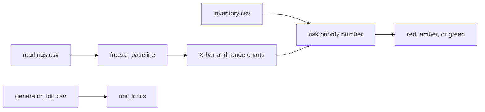

# ColdChain Monitor

ColdChain Monitor is a Shiny dashboard for a blood-bank operations manager. Each shift, it ranks the refrigerators that store red blood cells so the manager can service or evacuate a fridge before the bags leave 1–6 °C.

Team Keep It Cool. Cornell Six Sigma Hackathon, Virtual DL Challenge. Prompt: Blood Banks. The numbers are computed in plain R under `app/R/`. The Shiny page only displays them.

The walk-through of the three synthetic datasets, with the numbers the demo prints, is [demo/README.md](demo/README.md). The column codebook is [data/README.md](data/README.md). The method and the hand-check numbers are in [SPEC.md](SPEC.md) section 4.

## 1. Published app

The published app is [ColdChain Monitor on Posit Connect](https://connect.systems-apps.com/content/7da4a137-8c89-44c1-a191-7c9e9317f590/).

A logged-out browser loads that page. The content name is `rubberduckysmiles-Rwedoneyet-shiny`. The publisher key stays in GitHub Actions secrets and is not in this repo.

## 2. Run it in one command

From the repo root, after a fresh clone:

```bash
git clone https://github.com/rubberduckysmiles/Rwedoneyet
cd Rwedoneyet
Rscript app/testme.R
```

Then open http://127.0.0.1:5763. The demo CSVs load on their own. Stop the app with Ctrl-C.

Check the hand-worked numbers without opening a browser:

```bash
Rscript app/workflow.R
```

That prints `WORKFLOW OK` when the ten-hour example matches SPEC.md section 4. The same demo numbers, fridge by fridge, are:

```bash
Rscript demo/show_numbers.R
```

The test suite is:

```bash
Rscript -e 'testthat::test_dir("tests")'
```

Needs R with `shiny`, `bslib`, `plotly`, `DT`, and `testthat`. This copy was built on R 4.5.2. No API key is required to run it locally.

## 3. What the manager sees

Five pages: Overview, Fridge Detail, Capability, Generator, and Data.

| Page | What it shows |
|---|---|
| Overview | Fridges needing action, blood units at risk, average Ppk, and the last generator transfer. Fridge cards are sorted by risk priority number. A note says the limits are frozen from the first 48 hours. |
| Fridge Detail | An X-bar chart over a range chart over a standard deviation chart. The baseline is shaded on each. A flagged hour is marked, and the hover text is the test's plain-English meaning. Below them, the blood types in that fridge, with the at-risk bags of each type marked. |
| Capability | Cpk, Ppk, the gap, a histogram with lines at 1 °C, 3.5 °C, and 6 °C, a rolling 24-hour Ppk, and one sentence. |
| Generator | Individuals and moving-range charts for transfer time, with a line at 10 seconds. |
| Data | The three demo files, or three files the manager uploads, plus a button that reloads the demo. |

The badge colors mean the action, and nothing else uses them:

| Badge | Meaning | Rule |
|---|---|---|
| Red | Act this shift | Any reading in the last 24 hours is outside 1–6 °C, or X-bar test 1 fired after the baseline. |
| Amber | Watch | Any other special-cause test fired after the baseline, or Cpk is below 1.0, or the forecast crosses 1 °C or 6 °C within 12 hours. |
| Green | Leave it | None of the above. |
| Gray | No limits yet | Fewer than 25 complete baseline subgroups, and the fridge is not already red. |

The capability sentence uses the course threshold of 1.0:

- Cpk at least 1.0 and no special-cause flag: "capable and stable"
- Cpk at least 1.0 with a flag: "inside the spec width, but not stable"
- Cpk below 1.0: "not capable"

Units at risk are the bags in fridges that are outside 1–6 °C right now, or that have any special-cause flag in the last 24 hours. "Needing action" counts red and amber fridges.



## 4. Inputs

Only three files. All of the files in `data/` are synthetic. Seed 5300. Regenerate them from the repo root with `Rscript data/make_data.R`. Do not edit the CSVs by hand. After regenerating, copy the three CSVs into `app/data/` as well, because the published app bundles `app/data/`.

| File | Columns | What a technician records |
|---|---|---|
| `readings.csv` | `fridge_id`, `timestamp`, `temp_c` (°C), `door_open` (1 or 0), `on_generator` (1 or 0) | A probe in a glycerol bottle, every 15 minutes, plus the door contact and the power-monitor contact. |
| `inventory.csv` | `fridge_id`, `blood_type`, `blood_units` | The bag count and its ABO/Rh group from the shift sheet, one row per fridge per type. Totals per fridge are unchanged by the split. |
| `generator_log.csv` | `date`, `transfer_time_sec` | A stopwatch at the generator transfer test. Optional. |

The demo has six fridges, F01 through F06, from 2026-10-01 00:00:00 through 2026-10-07 23:45:00. Timestamps have no time zone. The planted stories, and how to read each number, are in [demo/README.md](demo/README.md).

## 5. Parameters

These are the defaults. They are arguments of the functions in section 6, not hidden constants in the page.

| Parameter | Default | Meaning |
|---|---|---|
| `subgroup_n` | 4 | Readings in one hour. One subgroup is one plotted point. |
| `baseline_subgroups` | 48 | First 48 hours. Limits are frozen from these and do not move later. |
| `min_subgroups` | 25 | Fewer complete baseline subgroups means no limits. |
| `lsl`, `usl` | 1 °C, 6 °C | Spec limits for red blood cells. These are not the control limits. |
| Target | 3.5 °C | The middle of the spec, drawn on the histogram. It is not the X-bar center. |
| `window` | 96 | Trailing raw readings for rolling Ppk. 96 readings are 24 hours. |
| Forecast hours | after hour 48 | The straight line uses only post-baseline subgroup means. |
| Generator spec | 10 seconds | Drawn on the individuals chart. It is not a control limit. |
| Capability cutoff | 1.0 | Course cutoff for "capable". |
| Urgency display | 72 hours | A crossing farther out, or none, is shown as "> 72 h". |

Minutes outside 1–6 °C in the last 24 hours are shown on the fridge. They are not part of the risk priority number.

## 6. How each function works

`app/qc.R` only sources the files in `app/R/`. Call the functions from R after `source("app/qc.R")`. A value that cannot be computed is `NA` with a `message` attribute (`attr(x, "message")`), never infinity and never 0 standing in for "undefined".

| Function | Arguments | What it returns |
|---|---|---|
| `subgroup_stats(x, n = 4)` | Readings in time order, and the subgroup size. | One row per subgroup: mean, sample variance, sd, range, and `n_obs`. Variance divides by n − 1. A subgroup with fewer than 2 readings has variance `NA`. |
| `sigma_short_from_variances(variances)` | The subgroup variances. | Square root of their mean. Missing variance returns `NA` with a message. |
| `sigma_overall(x)` | The readings. | Sample standard deviation of every reading, R's `sd`. |
| `lag1_autocorrelation(x)` | The baseline readings. | Correlation of each reading with the next one. Printed as a limitation. It does not widen the limits. Needs at least 3 readings. |
| `range_constants(n)` | Subgroup size, at least 2. | `d2` and `d3`, the mean and sd of the range of n standard normals. Computed with `ptukey` (`df = Inf`) and `integrate`. Not read from a table. |
| `xbar_limits(center, sigma_short, n)` | Grand mean, sigma short, subgroup size. | Center, standard error `sigma_short / sqrt(n)`, and limits at center ± 3 standard errors. Also the 1, 2, and 3 sigma zone distances. |
| `range_chart_limits(sigma_short, n)` | Sigma short and subgroup size. | Center `d2 * sigma_short`. Upper `(d2 + 3 d3) * sigma_short`. Lower `max(0, (d2 − 3 d3) * sigma_short)`. |
| `capability_indices(mean, sigma_short, sigma_overall, lsl = 1, usl = 6)` | Baseline mean and both sigmas. | `Cpk = min(usl − mean, mean − lsl) / (3 * sigma_short)`. `Ppk` uses `sigma_overall` in that denominator. `gap = Cpk − Ppk`. If a sigma is 0, that index and the gap are `NA` with the message "sigma is 0; Cpk and Ppk are undefined". |
| `freeze_baseline(values, subgroup_n = 4, baseline_subgroups = 48, min_subgroups = 25)` | One fridge, in time order. | Frozen X-bar limits, range limits, capability, lag-1, both sigmas, and the center. Uses only the first 48 complete subgroups. Fewer than 25 returns `limits = NULL`. |
| `special_cause_test_1(values, lower, upper)` through `special_cause_test_8(...)` | The plotted points. Tests 2 and 5–8 also take the center, and 5–8 take the standard error. | `list(indices, meaning)`. `indices` are the positions that complete the pattern. A point exactly on a line is not a flag. |
| `hours_to_spec(subgroup_means, lsl = 1, usl = 6)` | Post-baseline hourly means only. | Hours until the fitted line hits 1 °C or 6 °C. Already outside is 0. No crossing is `Inf` with message "no crossing". Fewer than 3 means is `NA`. |
| `rolling_ppk(values, lsl = 1, usl = 6, window = 96)` | Raw readings. | Ppk at each window end. Both sigmas are that window's own sd. A window with sd 0 is `NA`. |
| `severity_score(blood_units)` | Bag count, 0 or more. | 1 if 0 bags. Then 2 through 10 for 1–5, 6–15, 16–30, 31–50, 51–75, 76–100, 101–150, 151–200, and 201 or more. |
| `worst_occurrence(xbar_flags, range_test1, any_out_of_spec)` | Eight X-bar index vectors, the range-chart test 1 result, and whether any reading left 1–6 °C. | The worst score: 1 none; 2 test 6; 3 test 5 or 8; 4 test 4; 5 test 2; 6 test 7; 7 test 3; 8 range-chart test 1; 9 X-bar test 1 while inside spec; 10 any reading outside 1–6 °C. |
| `urgency_score(hours)` | Hours from `hours_to_spec`. | 10 if already out or within 2 hours. Then 9, 8, 7, 6, 5, 4, 3, 2, 1 for within 4, 8, 12, 18, 24, 36, 48, 72 hours, and beyond 72 hours or no crossing. |
| `rpn(severity, occurrence, urgency)` | Three integers from 1 to 10. | Their product. |
| `imr_limits(x)` | One transfer time per day. | Individuals center ± 3 sigma, with `sigma_short = (mean moving range) / d2` and `d2` computed at n = 2. Moving-range center is the mean moving range. Fewer than 2 values, a missing value, or a mean moving range of 0 returns `NA` limits with a message. |
| `analyze_fridge(...)` | One fridge's readings and its bag count. | Joins the functions above into the badge, the sentence, the hours, and the risk priority number. It does not add a new formula. |
| `analyze_all(readings, inventory)` | Both data frames. | One row per fridge, sorted by risk priority number, highest first. |
| `overview_summary(analyses, generator)` | The fridge rows and the generator log. | Needing action, units at risk, average Ppk, and the last transfer. |
| `bloodtype_table(inventory, fridge_id, units_at_risk)` | The inventory, one fridge's ID, and that fridge's at-risk bag count. | One row per blood type in that fridge: bag count, share of the fridge, and at-risk bags split by that share. Zero rows for a fridge with no inventory. No new formula. |
| `generator_analysis(generator)` | The generator log. | The I-MR limits plus the series to plot. |

The eight tests, in order:

| Test | Pattern | Meaning in the app |
|---|---|---|
| 1 | One point strictly outside the 3-sigma limits | A sudden temperature excursion. On the range chart, the same test uses the range limits. |
| 2 | Nine in a row strictly on one side of the center | The fridge has shifted. A point on the center breaks the run. |
| 3 | Six strictly rising or six strictly falling | Possible compressor wear. An equal step breaks the run. |
| 4 | Fourteen strictly alternating | The controller is hunting. |
| 5 | Two of three beyond 2 standard errors, same side | A shift is starting. |
| 6 | Four of five beyond 1 standard error, same side | A small sustained shift. |
| 7 | Fifteen strictly inside 1 standard error | Possible stuck sensor. |
| 8 | Eight strictly outside 1 standard error, either side | Two regimes mixed together. |

All eight run on the X-bar chart. Test 1 also runs on the range chart and on the standard deviation chart.

## 7. Why these statistics

This section is the reasoning. Every claim in it is a line of code in `app/R/`, and the function that implements it is named so a teammate can point at it.

### What a control limit is

Each hour is a subgroup of four readings, and one subgroup makes one plotted point. The **standard error** (SE) is how far a subgroup mean would move if the same fridge were sampled the same way again:

 SE = sigma_short / square root of subgroup_n

`sigma_short` is the square root of the mean within-hour sample variance, frozen from the first 48 hours only (`freeze_baseline`). `xbar_limits` puts the **control limits at the center plus or minus 3 SE**.

Three SE is wide on purpose. For a stable, roughly normal process about 99.7% of subgroup means land inside those lines, so a point outside is not ordinary wiggle — it is rare enough that we look for a cause instead of shrugging. That is the whole idea of a control chart: separate the variation the process always had from the variation that something *did*.

A point past the X-bar limits, after the baseline, has three consequences, and they are the consequences that matter:

- the fridge's badge goes **red** (`analyze_fridge`, the `test1_post` branch);
- if it happened within the last 24 hours, every bag in that fridge counts as a **unit at risk** (`units_at_risk`);
- a row appears in the **violations table**, carrying the hour and the test's plain-English meaning.

A point past the **range** limits is a different finding: the four readings in that hour disagree with each other. It does not make the fridge red, because `any_flag_post` puts it at **amber**, but a recent one still counts toward units at risk.

**Control limits are not spec limits.** Control limits describe what this fridge does. The spec limits, 1 °C and 6 °C, describe what red blood cells need. A fridge can be perfectly in control at the wrong temperature, and it can be out of control while every reading is still inside the spec. The app keeps the two apart on purpose.

### The eight special-cause tests

All eight run on the X-bar chart. Test 1 also runs on the range chart and on the standard deviation chart. Every comparison is strict, so a point exactly on a line is never a flag (`special_cause_tests.R`).

| Test | Pattern | Plain meaning | Why that pattern is bad for stored red cells |
|---|---|---|---|
| 1 | One point strictly outside the 3-sigma limits | A sudden temperature excursion | One hour has gone far enough from the setpoint that the bags in that fridge may already be moving out of 1–6 °C. This is the pattern that ends with a bag being discarded. |
| 2 | Nine in a row strictly on one side of the center | The fridge has shifted | No single hour is out of limits, but the whole fridge now runs at a different temperature. Nine hours is most of a shift. Bags held at a temperature that is wrong but not extreme still lose shelf life. |
| 3 | Six strictly rising, or six strictly falling | Possible compressor wear | A steady one-way drift means the fridge is losing its grip on temperature. It has not failed yet, but it is heading for a spec limit and will reach one if nothing is done. This is the pattern `hours_to_spec` exists to catch early. |
| 4 | Fourteen strictly alternating up and down | The controller is hunting | The thermostat over-corrects, swinging above and below the setpoint. The bags spend part of every cycle near the warm edge and part near the cold edge, so the temperature they experience is not the one on the display. |
| 5 | Two of three beyond 2 SE, same side | A shift is starting | The shift has begun but is not complete. The fridge is still inside its limits, so there is still time to service it before any bag leaves spec. |
| 6 | Four of five beyond 1 SE, same side | A small sustained shift | A smaller version of test 2: the fridge runs biased warm or cool by a little, all shift. Small and persistent is still hours of storage at the wrong temperature. |
| 7 | Fifteen strictly inside 1 SE | Possible stuck sensor | This one is about the measurement, not the fridge. A real refrigerator does not hold temperature that still. If the readings are that flat the probe may have failed — and a failed probe means every other number on the page is computed from data that is not real. |
| 8 | Eight strictly outside 1 SE, either side | Two regimes mixed together | The fridge spends all its time away from the center, alternating warm and cold. The center is no longer a fair description of how it runs, so the limits drawn around it no longer describe the process. |

### Why X-bar and range are the primary pair

Two charts, because they answer two different questions and both are needed.

**X-bar answers "is the temperature right?"** The spec is a temperature, so the center of the analysis has to be a temperature. A subgroup mean is the honest summary of an hour: it uses all four readings and hides none of them.

**Range answers "is the hour steady?"** Four readings taken across one hour should agree closely. A wide range means the temperature swung *within* the hour, which the mean would conceal. An hour averaging 3.5 °C while ranging from 2.5 to 4.5 °C is not the same as an hour sitting at 3.5 °C, and only the range chart tells them apart.

The pair is also cheap and hard to get wrong. The range converts to a sigma estimate through `d2` and `d3`, which `range_constants` computes with `ptukey` and `integrate` rather than reading from a table.

### What the standard deviation chart adds

The range uses only the largest and the smallest of the four readings; the middle two are discarded. The standard deviation uses all four. So the s-chart notices a change in spread that never moves the extremes — the readings bunching tighter, or spreading out without producing a new maximum or minimum.

The price of that sensitivity is a correction. The expected value of s is not sigma, it is `c4 * sigma`, so the s-chart's center is `c4 * sigma_short` and its lines are `B5 * sigma_short` and `B6 * sigma_short` (`sd_chart_limits`). Those three constants depend only on the subgroup size, and `sd_constants` computes them with `lgamma` instead of looking them up, so they stay correct for any subgroup size.

**The s-chart is display only.** Its flags are drawn on their own chart and feed nothing else — not the badge, not the risk priority number, not the units at risk, not the violations table. The range chart already carries the dispersion signal into those numbers, and adding a third input would move every published figure.

### What the Cpk and Ppk split means

Both index the same thing: how much room sits between the temperature the fridge runs at and the nearer of the two spec limits, measured in sigmas. Both are read against the course cutoff of 1.0. They differ only in which sigma goes in the denominator (`capability_indices`).

**Cpk uses `sigma_short`**, the within-hour spread. It answers: *if this fridge holds the way it is calibrated to hold*, how much margin is there?

**Ppk uses `sigma_overall`**, the sample standard deviation of every baseline reading. It answers: *across the whole baseline*, including drift and hour-to-hour movement, how much margin is there?

**`gap = Cpk − Ppk`** is the honest part of the pair:

| Reading | What it is telling you |
|---|---|
| Gap near zero | The fridge performs the same way hour to hour as it does overall. It is stable. |
| Cpk well above Ppk, gap clearly positive | Within an hour the fridge is fine, but the overall picture is worse. It drifts or shifts between hours. That is a *stability* problem, not a capability problem: the fridge can hold temperature, it does not hold it consistently. |
| Both below 1.0 | The fridge cannot reliably hold the spec at all, even within an hour. That is a capability problem. |

If every reading is exactly 3.5 °C then both sigmas are 0, and `capability_indices` returns `NA` with the message "sigma is 0; Cpk and Ppk are undefined" — never infinity, and never a 0 standing in for "undefined".

### What the operations manager does with each number

| Number | What it means | What you do with it |
|---|---|---|
| **Badge** | The action. Nothing else uses the colors. | **Red:** act this shift, service or evacuate. **Amber:** watch, and check it on the next round. **Green:** leave it. **Gray:** not enough baseline yet, keep collecting readings. |
| **Cpk** | Margin to the nearer spec limit, using the within-hour spread | Below 1.0 the fridge cannot reliably hold spec. Plan to service or replace it. |
| **Ppk** | The same margin, using every baseline reading | Read it against Cpk, not instead of Cpk. |
| **Gap** | Cpk − Ppk | Near zero: stable. Clearly positive: the fridge drifts between hours — look at the door, the load, the compressor. |
| **Hours to spec** | How long the fitted line needs to reach 1 °C or 6 °C | This is the deadline. Under 12 hours means plan the transfer now. "already out" means move the bags. |
| **Units at risk** | Bags in a fridge that is out now, or that flagged in the last 24 hours | This is what you are protecting, and the number to quote when you ask for help. |
| **Risk priority number** | Severity × occurrence × urgency, each 1 to 10 | It ranks the fridges, and the Overview sorts by it. Higher acts first. It is a sorting key, not a probability. |
| **Severity** | The fridge's own bag count, banded 1 to 10 | More bags is more severe, because more product is exposed to the same failure. |
| **Occurrence** | The worst special-cause pattern that fired | 10 is a reading outside 1–6 °C. 9 is X-bar test 1 while still inside spec. It falls to 1 for nothing at all. |
| **Urgency** | How soon the forecast reaches a spec limit | Sooner is higher. Already out, or under 2 hours, is 10. |
| **Lag-1** | How much each reading depends on the one before it | A limitation, printed rather than corrected. A large value means the tests fire more often than the limits alone suggest. |
| **Rolling 24-hour Ppk** | Capability now, against the baseline's | A falling line means the fridge is getting worse. |
| **Minutes outside 1–6 °C** | A direct count over the last 24 hours | The raw evidence, shown on the fridge card. It is not part of the risk priority number. |
| **The 10-second generator line** | A threshold the team chose. It is not a control limit and not a spec limit. | Set it for your own site's transfer test. |

**A worked example: F02 in the demo.** F02 is red, holds 180 bags, and reports Cpk 6.151, Ppk 5.864, hours "already out", and a risk priority number of 900. Read together: severity is 9 because 180 bags falls in the 151–200 band; urgency is 10 because the fitted line has already reached a spec limit; occurrence is 10 because at least one reading left 1–6 °C. 9 × 10 × 10 = 900. The capability sentence is "inside the spec width, but not stable" — the hour means sit comfortably inside 1–6 °C, so Cpk is high, but the readings have left that band and the fridge is drifting. That is why all 180 of its bags are counted at risk, and why a point past the X-bar limits would matter: it is the signal that turns a fridge like this one from something you watch into something you act on.

## 8. Hand check

Ten hours, four readings each, every hour mean exactly 3.5 °C. The rows are in SPEC.md section 4 and in `tests/known_rows.R`.

| Quantity | Value |
|---|---|
| Sigma short | 0.2569046516 |
| Sigma overall | 0.2253202849 |
| X-bar limits | 3.1146430226 and 3.8853569774 |
| Range center, upper, lower | 0.5289026431, 1.2069831025, 0 |
| Cpk, Ppk, gap | 3.2437456007, 3.6984390192, −0.4546934185 |
| Lag-1 | −0.2174115934 |

The gap is negative on this set because the hour means do not move: the same sum of squares is divided by 39 for sigma overall and, through the subgroup variances, by 30 for sigma short. The drift check in SPEC.md section 4 makes the gap positive. If every reading is 3.5 °C, both sigmas are 0 and Cpk and Ppk are missing. They are never infinity.

For the subgroup size, `range_constants(4)` gives d2 = 2.0587507460 and d3 = 0.8798082028. `range_constants(5)` gives d2 = 2.3259289473 and d3 = 0.8640819411.

## 9. Assumptions

Sample variances divide by n − 1. The 3-sigma limits assume a normal, independent process. Readings 15 minutes apart can be autocorrelated, so a test can flag a fridge that has no planted failure. The app prints lag-1 and does not widen the limits to compensate. Control limits are not spec limits. The risk priority number here is severity × occurrence × urgency, with urgency standing in for the usual detection score, because the decision is about time until the fridge leaves the spec.

Out of scope: costs, multi-site comparison, and attribute charts.
