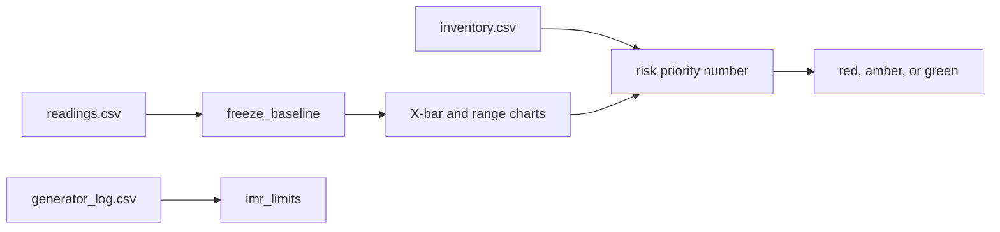

# ColdChain Monitor

ColdChain Monitor is a Shiny dashboard for a blood-bank operations manager. Each shift, it ranks the refrigerators that store red blood cells so the manager can service or evacuate a fridge before the bags leave 1–6 °C.

Team Keep It Cool. Cornell Six Sigma Hackathon, Virtual DL Challenge. Prompt: Blood Banks. The numbers are computed in plain R under `app/R/`. The Shiny page only displays them.

The walk-through of the three synthetic datasets, with the numbers the demo prints, is [demo/README.md](demo/README.md). The column codebook is [data/README.md](data/README.md). The method and the hand-check numbers are in [SPEC.md](SPEC.md) section 4.

## 1. Published app

The published app is [ColdChain Monitor on Posit Connect](https://connect.systems-apps.com/content/7da4a137-8c89-44c1-a191-7c9e9317f590/).

A logged-out browser loads that page. The content name is `rubberduckysmiles-Rwedoneyet-shiny`. The publisher key stays in GitHub Actions secrets and is not in this repo.

## 2. Run it in one command

From the repo root, after a fresh clone:

```bash
git clone https://github.com/rubberduckysmiles/Rwedoneyet
cd Rwedoneyet
Rscript app/testme.R
```

Then open http://127.0.0.1:5763. The demo CSVs load on their own. Stop the app with Ctrl-C.

Check the hand-worked numbers without opening a browser:

```bash
Rscript app/workflow.R
```

That prints `WORKFLOW OK` when the ten-hour example matches SPEC.md section 4. The same demo numbers, fridge by fridge, are:

```bash
Rscript demo/show_numbers.R
```

The test suite is:

```bash
Rscript -e 'testthat::test_dir("tests")'
```

Needs R with `shiny`, `bslib`, `plotly`, `DT`, and `testthat`. This copy was built on R 4.5.2. No API key is required to run it locally.

## 3. What the manager sees

Five pages: Overview, Fridge Detail, Capability, Generator, and Data.

| Page | What it shows |
|---|---|
| Overview | Fridges needing action, blood units at risk, average Ppk, and the last generator transfer. Fridge cards are sorted by risk priority number. A note says the limits are frozen from the first 48 hours. |
| Fridge Detail | An X-bar chart over a range chart. The baseline is shaded. A flagged hour is marked, and the hover text is the test's plain-English meaning. Below them, the blood types in that fridge, with the at-risk bags of each type marked. |
| Capability | Cpk, Ppk, the gap, a histogram with lines at 1 °C, 3.5 °C, and 6 °C, a rolling 24-hour Ppk, and one sentence. |
| Generator | Individuals and moving-range charts for transfer time, with a line at 10 seconds. |
| Data | The three demo files, or three files the manager uploads, plus a button that reloads the demo. |

The badge colors mean the action, and nothing else uses them:

| Badge | Meaning | Rule |
|---|---|---|
| Red | Act this shift | Any reading in the last 24 hours is outside 1–6 °C, or X-bar test 1 fired after the baseline. |
| Amber | Watch | Any other special-cause test fired after the baseline, or Cpk is below 1.0, or the forecast crosses 1 °C or 6 °C within 12 hours. |
| Green | Leave it | None of the above. |
| Gray | No limits yet | Fewer than 25 complete baseline subgroups, and the fridge is not already red. |

The capability sentence uses the course threshold of 1.0:

- Cpk at least 1.0 and no special-cause flag: "capable and stable"
- Cpk at least 1.0 with a flag: "inside the spec width, but not stable"
- Cpk below 1.0: "not capable"

Units at risk are the bags in fridges that are outside 1–6 °C right now, or that have any special-cause flag in the last 24 hours. "Needing action" counts red and amber fridges.



## 4. Inputs

Only three files. All of the files in `data/` are synthetic. Seed 5300. Regenerate them from the repo root with `Rscript data/make_data.R`. Do not edit the CSVs by hand. After regenerating, copy the three CSVs into `app/data/` as well, because the published app bundles `app/data/`.

| File | Columns | What a technician records |
|---|---|---|
| `readings.csv` | `fridge_id`, `timestamp`, `temp_c` (°C), `door_open` (1 or 0), `on_generator` (1 or 0) | A probe in a glycerol bottle, every 15 minutes, plus the door contact and the power-monitor contact. |
| `inventory.csv` | `fridge_id`, `blood_type`, `blood_units` | The bag count and its ABO/Rh group from the shift sheet, one row per fridge per type. Totals per fridge are unchanged by the split. |
| `generator_log.csv` | `date`, `transfer_time_sec` | A stopwatch at the generator transfer test. Optional. |

The demo has six fridges, F01 through F06, from 2026-10-01 00:00:00 through 2026-10-07 23:45:00. Timestamps have no time zone. The planted stories, and how to read each number, are in [demo/README.md](demo/README.md).

## 5. Parameters

These are the defaults. They are arguments of the functions in section 6, not hidden constants in the page.

| Parameter | Default | Meaning |
|---|---|---|
| `subgroup_n` | 4 | Readings in one hour. One subgroup is one plotted point. |
| `baseline_subgroups` | 48 | First 48 hours. Limits are frozen from these and do not move later. |
| `min_subgroups` | 25 | Fewer complete baseline subgroups means no limits. |
| `lsl`, `usl` | 1 °C, 6 °C | Spec limits for red blood cells. These are not the control limits. |
| Target | 3.5 °C | The middle of the spec, drawn on the histogram. It is not the X-bar center. |
| `window` | 96 | Trailing raw readings for rolling Ppk. 96 readings are 24 hours. |
| Forecast hours | after hour 48 | The straight line uses only post-baseline subgroup means. |
| Generator spec | 10 seconds | Drawn on the individuals chart. It is not a control limit. |
| Capability cutoff | 1.0 | Course cutoff for "capable". |
| Urgency display | 72 hours | A crossing farther out, or none, is shown as "> 72 h". |

Minutes outside 1–6 °C in the last 24 hours are shown on the fridge. They are not part of the risk priority number.

## 6. How each function works

`app/qc.R` only sources the files in `app/R/`. Call the functions from R after `source("app/qc.R")`. A value that cannot be computed is `NA` with a `message` attribute (`attr(x, "message")`), never infinity and never 0 standing in for "undefined".

| Function | Arguments | What it returns |
|---|---|---|
| `subgroup_stats(x, n = 4)` | Readings in time order, and the subgroup size. | One row per subgroup: mean, sample variance, sd, range, and `n_obs`. Variance divides by n − 1. A subgroup with fewer than 2 readings has variance `NA`. |
| `sigma_short_from_variances(variances)` | The subgroup variances. | Square root of their mean. Missing variance returns `NA` with a message. |
| `sigma_overall(x)` | The readings. | Sample standard deviation of every reading, R's `sd`. |
| `lag1_autocorrelation(x)` | The baseline readings. | Correlation of each reading with the next one. Printed as a limitation. It does not widen the limits. Needs at least 3 readings. |
| `range_constants(n)` | Subgroup size, at least 2. | `d2` and `d3`, the mean and sd of the range of n standard normals. Computed with `ptukey` (`df = Inf`) and `integrate`. Not read from a table. |
| `xbar_limits(center, sigma_short, n)` | Grand mean, sigma short, subgroup size. | Center, standard error `sigma_short / sqrt(n)`, and limits at center ± 3 standard errors. Also the 1, 2, and 3 sigma zone distances. |
| `range_chart_limits(sigma_short, n)` | Sigma short and subgroup size. | Center `d2 * sigma_short`. Upper `(d2 + 3 d3) * sigma_short`. Lower `max(0, (d2 − 3 d3) * sigma_short)`. |
| `capability_indices(mean, sigma_short, sigma_overall, lsl = 1, usl = 6)` | Baseline mean and both sigmas. | `Cpk = min(usl − mean, mean − lsl) / (3 * sigma_short)`. `Ppk` uses `sigma_overall` in that denominator. `gap = Cpk − Ppk`. If a sigma is 0, that index and the gap are `NA` with the message "sigma is 0; Cpk and Ppk are undefined". |
| `freeze_baseline(values, subgroup_n = 4, baseline_subgroups = 48, min_subgroups = 25)` | One fridge, in time order. | Frozen X-bar limits, range limits, capability, lag-1, both sigmas, and the center. Uses only the first 48 complete subgroups. Fewer than 25 returns `limits = NULL`. |
| `special_cause_test_1(values, lower, upper)` through `special_cause_test_8(...)` | The plotted points. Tests 2 and 5–8 also take the center, and 5–8 take the standard error. | `list(indices, meaning)`. `indices` are the positions that complete the pattern. A point exactly on a line is not a flag. |
| `hours_to_spec(subgroup_means, lsl = 1, usl = 6)` | Post-baseline hourly means only. | Hours until the fitted line hits 1 °C or 6 °C. Already outside is 0. No crossing is `Inf` with message "no crossing". Fewer than 3 means is `NA`. |
| `rolling_ppk(values, lsl = 1, usl = 6, window = 96)` | Raw readings. | Ppk at each window end. Both sigmas are that window's own sd. A window with sd 0 is `NA`. |
| `severity_score(blood_units)` | Bag count, 0 or more. | 1 if 0 bags. Then 2 through 10 for 1–5, 6–15, 16–30, 31–50, 51–75, 76–100, 101–150, 151–200, and 201 or more. |
| `worst_occurrence(xbar_flags, range_test1, any_out_of_spec)` | Eight X-bar index vectors, the range-chart test 1 result, and whether any reading left 1–6 °C. | The worst score: 1 none; 2 test 6; 3 test 5 or 8; 4 test 4; 5 test 2; 6 test 7; 7 test 3; 8 range-chart test 1; 9 X-bar test 1 while inside spec; 10 any reading outside 1–6 °C. |
| `urgency_score(hours)` | Hours from `hours_to_spec`. | 10 if already out or within 2 hours. Then 9, 8, 7, 6, 5, 4, 3, 2, 1 for within 4, 8, 12, 18, 24, 36, 48, 72 hours, and beyond 72 hours or no crossing. |
| `rpn(severity, occurrence, urgency)` | Three integers from 1 to 10. | Their product. |
| `imr_limits(x)` | One transfer time per day. | Individuals center ± 3 sigma, with `sigma_short = (mean moving range) / d2` and `d2` computed at n = 2. Moving-range center is the mean moving range. Fewer than 2 values, a missing value, or a mean moving range of 0 returns `NA` limits with a message. |
| `analyze_fridge(...)` | One fridge's readings and its bag count. | Joins the functions above into the badge, the sentence, the hours, and the risk priority number. It does not add a new formula. |
| `analyze_all(readings, inventory)` | Both data frames. | One row per fridge, sorted by risk priority number, highest first. |
| `overview_summary(analyses, generator)` | The fridge rows and the generator log. | Needing action, units at risk, average Ppk, and the last transfer. |
| `bloodtype_table(inventory, fridge_id, units_at_risk)` | The inventory, one fridge's ID, and that fridge's at-risk bag count. | One row per blood type in that fridge: bag count, share of the fridge, and at-risk bags split by that share. Zero rows for a fridge with no inventory. No new formula. |
| `generator_analysis(generator)` | The generator log. | The I-MR limits plus the series to plot. |

The eight tests, in order:

| Test | Pattern | Meaning in the app |
|---|---|---|
| 1 | One point strictly outside the 3-sigma limits | A sudden temperature excursion. On the range chart, the same test uses the range limits. |
| 2 | Nine in a row strictly on one side of the center | The fridge has shifted. A point on the center breaks the run. |
| 3 | Six strictly rising or six strictly falling | Possible compressor wear. An equal step breaks the run. |
| 4 | Fourteen strictly alternating | The controller is hunting. |
| 5 | Two of three beyond 2 standard errors, same side | A shift is starting. |
| 6 | Four of five beyond 1 standard error, same side | A small sustained shift. |
| 7 | Fifteen strictly inside 1 standard error | Possible stuck sensor. |
| 8 | Eight strictly outside 1 standard error, either side | Two regimes mixed together. |

All eight run on the X-bar chart. Only test 1 runs on the range chart.

## 7. Hand check

Ten hours, four readings each, every hour mean exactly 3.5 °C. The rows are in SPEC.md section 4 and in `tests/known_rows.R`.

| Quantity | Value |
|---|---|
| Sigma short | 0.2569046516 |
| Sigma overall | 0.2253202849 |
| X-bar limits | 3.1146430226 and 3.8853569774 |
| Range center, upper, lower | 0.5289026431, 1.2069831025, 0 |
| Cpk, Ppk, gap | 3.2437456007, 3.6984390192, −0.4546934185 |
| Lag-1 | −0.2174115934 |

The gap is negative on this set because the hour means do not move: the same sum of squares is divided by 39 for sigma overall and, through the subgroup variances, by 30 for sigma short. The drift check in SPEC.md section 4 makes the gap positive. If every reading is 3.5 °C, both sigmas are 0 and Cpk and Ppk are missing. They are never infinity.

For the subgroup size, `range_constants(4)` gives d2 = 2.0587507460 and d3 = 0.8798082028. `range_constants(5)` gives d2 = 2.3259289473 and d3 = 0.8640819411.

## 8. Assumptions

Sample variances divide by n − 1. The 3-sigma limits assume a normal, independent process. Readings 15 minutes apart can be autocorrelated, so a test can flag a fridge that has no planted failure. The app prints lag-1 and does not widen the limits to compensate. Control limits are not spec limits. The risk priority number here is severity × occurrence × urgency, with urgency standing in for the usual detection score, because the decision is about time until the fridge leaves the spec.

Out of scope: costs, multi-site comparison, and attribute charts.
